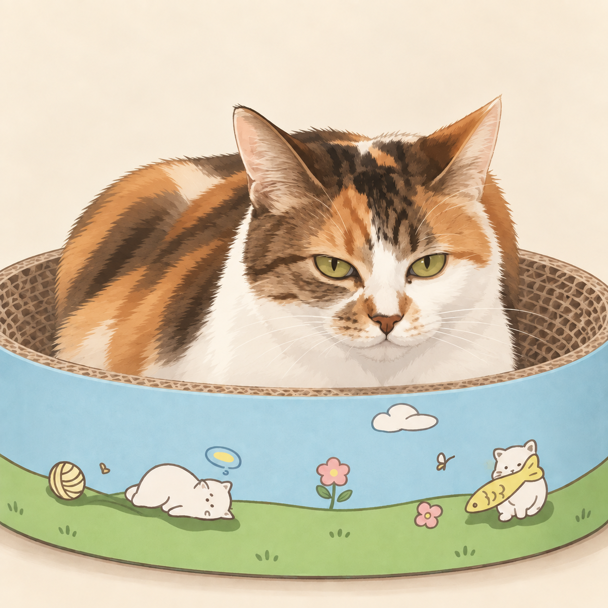
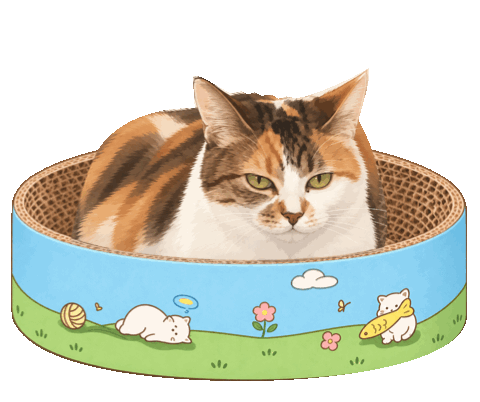

# Cat Companion / 猫咪陪伴

A small native macOS desktop cat. Pet its head, stroke its back, or bring out a ball and let it reach for it. Daily interaction goals unlock cosmetic rewards, with progress stored on your Mac.



The image above is the source illustration, not an application screenshot.

[中文说明](README.zh-CN.md) · [Build and test](docs/BUILDING.md) · [Architecture](docs/ARCHITECTURE.md) · [Privacy](docs/PRIVACY.md)

## What it does

- Native Swift/AppKit desktop window with layered artwork and responsive petting and ball interactions.
- Daily petting and play goals, persistent growth and cosmetic rewards; missed days do not remove progress.
- Optional always-on-top mode and reduced-motion support.
- A local illustrated letter reader, shipped with a neutral example letter.
- No application accounts, telemetry or network services.

The desktop app and the older browser prototype are separate implementations. The browser prototype does not reproduce every native feature.

## Try it on your Mac

**macOS 14+ · Chinese interface · experimental manual install**

[Download macOS preview ZIP](https://github.com/hhhhhhhhzs051-dev/cat-companion/releases/download/v1.1.1-preview.1/Cat-Companion-Open-Source-macOS-manual.zip) · [First launch](docs/TRY-IT.md) · [Release downloads](https://github.com/hhhhhhhhzs051-dev/cat-companion/releases) · [Interaction demo](docs/DEMO.md)

The ZIP includes the application, English/Chinese instructions and licenses. [Download its SHA-256 checksum](https://github.com/hhhhhhhhzs051-dev/cat-companion/releases/download/v1.1.1-preview.1/SHA256SUMS.txt). GitHub's “Source code” ZIP is not a runnable app. Preview binaries are ad-hoc signed, not Apple-notarized; first launch on another Mac remains unverified.



This is a rendered head-pet demonstration, not a screen recording. See [demo details](docs/DEMO.md).

## Build from source

Requires macOS 14+, Xcode Command Line Tools with a macOS SDK, Python 3 and Node.js 18+ for the browser tests. No third-party app runtime packages are required. This app's interface and default messages are currently in Chinese.

```sh
zsh scripts/check-core.sh       # model tests; no GUI launch
zsh scripts/build-macos.sh      # full local verification, then universal app build
```

The build produces `.build/macos/Cat Companion Open Source.app`. It does not install or launch the app. The public build uses the separate identifier `local.catcompanion.opensource` and its own local data directory.

The default signature is ad hoc. The preview is not notarized; see [build limitations](docs/BUILDING.md). Intel compilation is not the same as testing on an Intel Mac.

## Project status

This initial public source snapshot is derived from a locally maintained application. Public usage and cross-machine validation have not yet been established. No downloads, stars or community adoption are claimed.

## Contributing

Small, reproducible bug reports and focused patches are welcome. Read [CONTRIBUTING.md](CONTRIBUTING.md) before changing animation timing, storage or default behavior. Development and testing used AI coding assistance; raster artwork includes AI-assisted generation and compositing, as described in [ASSETS.md](ASSETS.md).

## License

Code and documentation: [MIT](LICENSE). Artwork: [CC BY 4.0](ASSETS-LICENSE.md), to the extent the contributors hold licensable rights. Third-party trademarks and other third-party rights are not granted. Asset provenance and known gaps are listed in [ASSETS.md](ASSETS.md).
