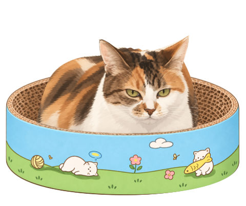
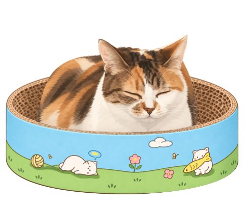

# Interaction demo / 动作演示


This 3.6-second loop uses the public app's `CatMotion` and `NativeCatView` code with the production rendering definitions. A head pet is triggered at 0.8 seconds. It is an offscreen render, **not a screen recording**: the menu, pointer, ball, growth panel and desktop are not shown. It does not demonstrate installation success or user input handling.

这段 3.6 秒循环直接使用公开版的动作模型与原生渲染器，在第 0.8 秒触发一次摸头。它是离屏渲染，**不是实机录屏**；不包含菜单、鼠标、小球、成长面板或私人桌面，也不用于证明安装与鼠标操作已通过。

## Still frames / 静态图

| Rest / 睁眼 | Head pet / 摸头闭眼 |
| --- | --- |
|  |  |

To reproduce on a Mac with the build tools installed / 在已安装构建工具的 Mac 上重新生成：

```sh
zsh scripts/render-demo.sh
```

The renderer writes only these documentation images and a local executable under `.build/docs`. It does not launch the app, read user data, or change preferences. Images use the [artwork license](../ASSETS-LICENSE.md). AI-assisted source artwork and provenance gaps are disclosed in [ASSETS.md](../ASSETS.md).

[Download and first launch](TRY-IT.md) · [中文下载与试用](TRY-IT.zh-CN.md)
